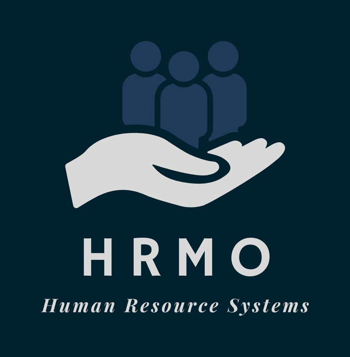
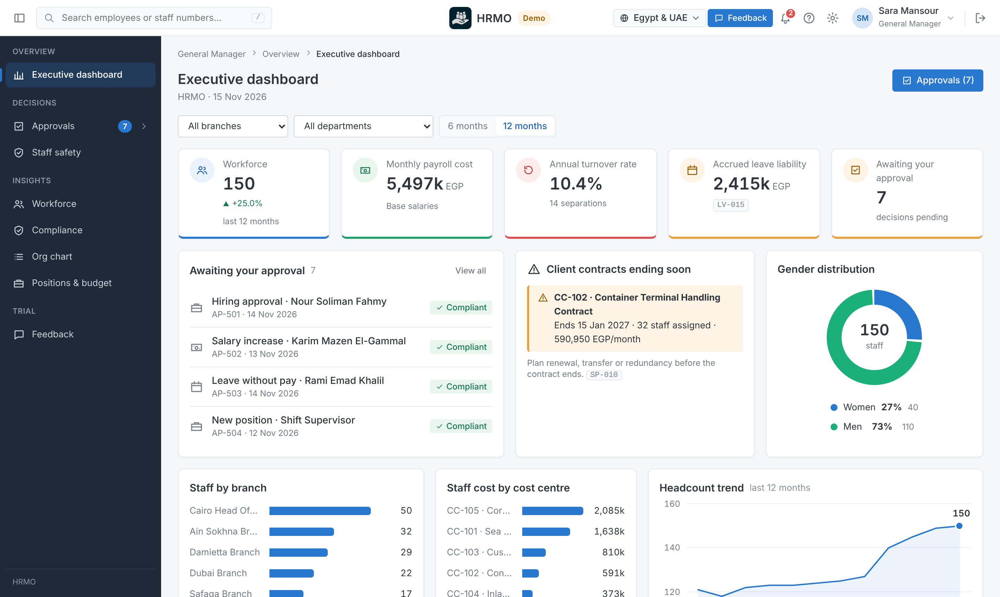
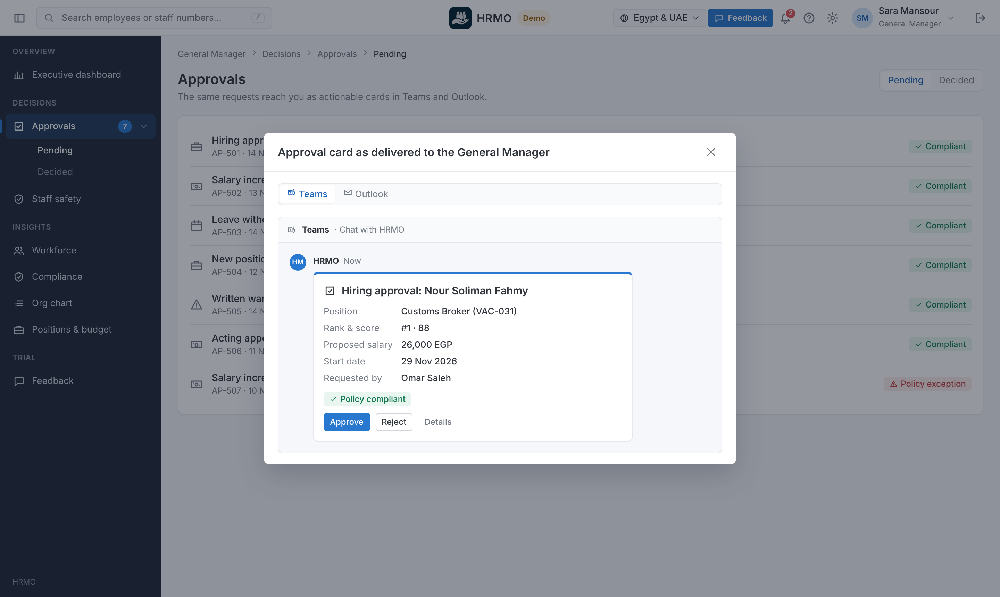
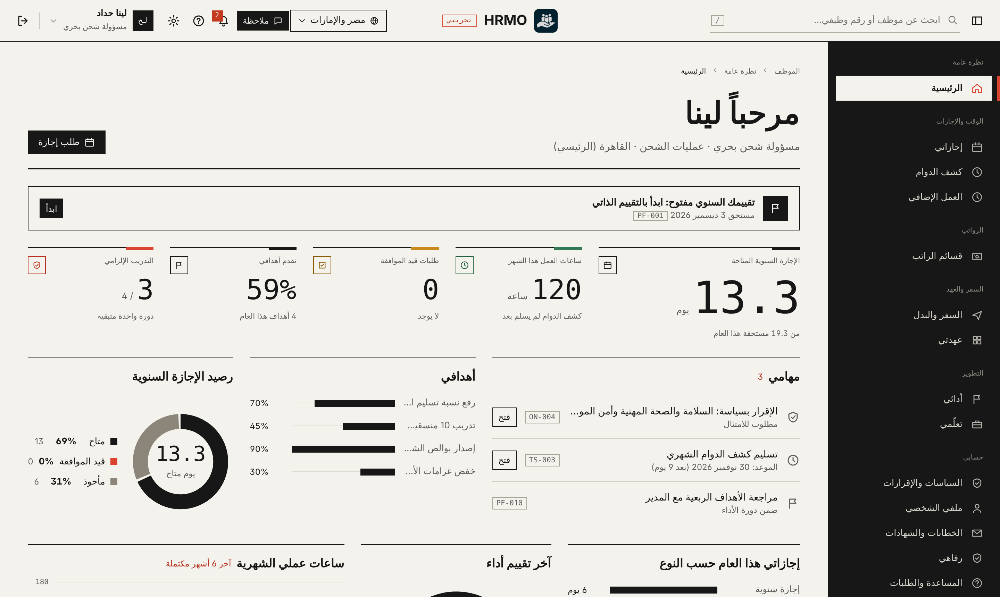
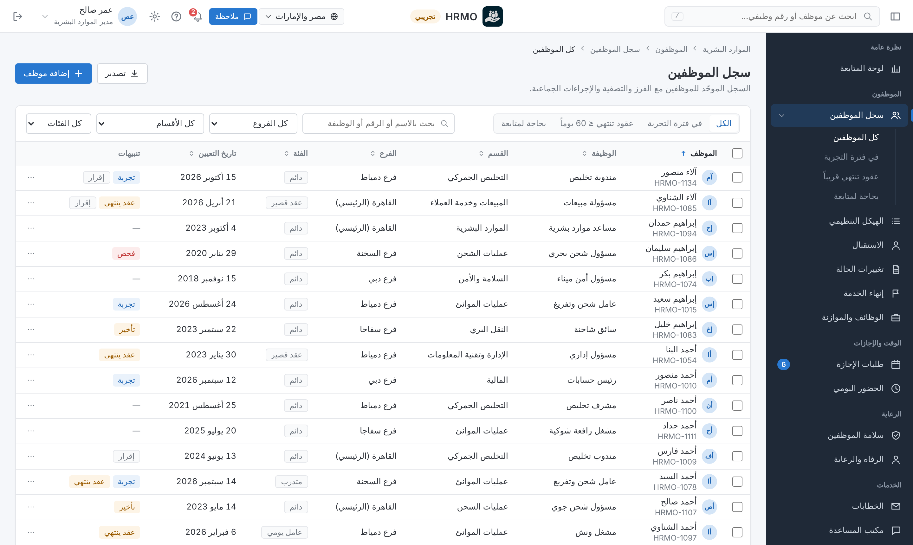
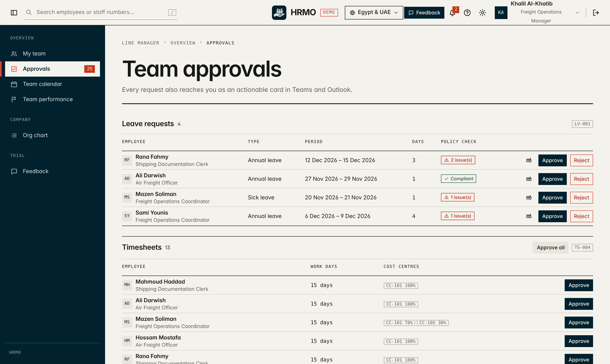
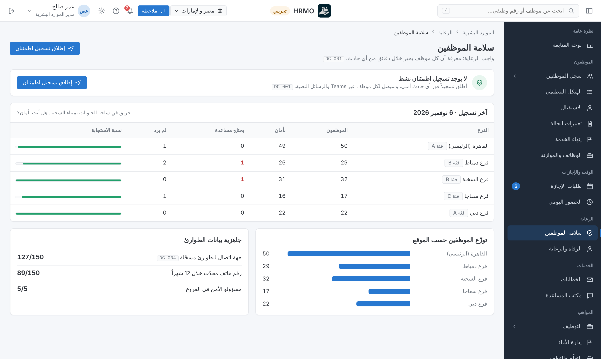

# HRMO

**English** · [العربية](#العربية)

HRMO is a configurable human resources management system for companies that work across several branches and countries. This edition is configured for a shipping and logistics company with a head office in Cairo and four branches that report directly to it: Damietta, Ain Sokhna, Safaga and Dubai. It is built on Microsoft Azure and runs entirely within the Microsoft ecosystem: staff sign in with their work account and use it from the browser, Microsoft Teams and Outlook.

## Why HRMO

A shipping company manages office staff, customs brokers, port crews, drivers and warehouse teams across ports and countries, each under its own labour law, working week and currency. HRMO puts the whole employee lifecycle in one place and applies the company's own policies automatically, so that every request is checked the same way and every decision is recorded.

- **Policy-driven.** Leave entitlements, notice periods, approval levels, probation, overtime and every other rule are settings, not code. Each country of operation has its own policy set and currency: Egypt in Egyptian pounds, the UAE in dirhams.
- **Built for ports and branches.** Cost centres and client contracts, site allowances, rotation rest at remote ports, safety check-ins after an incident, operating licences and a branch support pool are part of the system.
- **One structure.** Every branch manager reports to the General Manager at the head office, and the organization chart is drawn from each employee's line manager.
- **Inside Microsoft.** Sign-in, approvals in Teams and Outlook, documents and data all stay within the company's Microsoft environment.
- **Arabic and English.** Full right-to-left support, on desktop and phone.

## Who uses it

| Workspace | What it covers |
|---|---|
| **Employee** | Leave requests with instant policy checks, timesheets with cost-centre allocation, overtime, payslips, letters and certificates, performance and objectives, learning, travel, equipment, declarations, HR helpdesk, wellbeing and confidential support |
| **Line manager** | Team overview, one inbox for all approvals, team leave calendar, performance reviews and improvement plans, organization chart |
| **HR** | Employee directory, recruitment, onboarding, changes of status, separations and final settlement, positions and budget, leave and attendance, performance cycle, learning, staff safety, wellbeing, professional licences, cases and grievances, travel, assets, audit log and policy settings |
| **General Manager** | Executive dashboard, approvals, workforce cost by cost centre in one currency, client contracts ending soon, liabilities, diversity and localization, staff safety |

## Modules

**Employee lifecycle**
- Recruitment with mandatory steps: budgeted position, panel evaluation, reference checks, criminal record and port security pass
- Onboarding checklists, probation follow-up and contract renewals
- Changes of status: promotion, transfer, salary and cost-centre changes, with approval
- Separation: resignation, clearance by department, final settlement and exit evaluation

**Time and pay**
- Leave of all types, with balances, carry-over and holiday calendars
- Daily attendance, monthly timesheets split by cost centre, overtime
- Payslips and validated payroll inputs for the finance system

**Performance and learning**
- Annual and probation appraisals, objectives and improvement plans
- Training catalogue, mandatory courses and training needs

**Duty of care**
- Safety check-ins after an incident, with live headcount by branch
- Rotation rest at remote ports, burnout watch and site allowance
- Confidential employee support requests
- Licence tracking: customs broker, heavy vehicle, crane and forklift, dangerous goods, port security

**Employee relations**
- Disciplinary cases with a warning ladder and expiry dates
- Grievances with escalation deadlines
- Conflict of interest and gift declarations
- HR helpdesk with response targets

**Company**
- Positions and budget against cost centres
- Organization chart, travel and security clearance, assets
- Branch support pool for vessel peaks
- HR indicators and reports for management

## Approvals in Teams and Outlook

Every request reaches its approver as a card in Teams and Outlook. The card shows the request, the result of the policy checks and the approve and reject buttons, so a manager can decide without opening the system. Each decision is recorded with who made it, when and from where.

## Security and privacy

- Data stays in the company's own Azure subscription, in the region it chooses.
- Sign-in uses Microsoft Entra ID, so the company's own security rules apply.
- Each person sees only what their role allows: employees see their own record, managers see their team, and salary and private data are restricted to HR and management.
- Every change keeps its history, and the audit log cannot be edited.
- Reports of harassment, fraud and bribery are not collected in the system. Staff are directed to the company's independent reporting channel.

## Company structure

| Location | Role | Country | Policy set | Currency |
|---|---|---|---|---|
| Cairo | Head office | Egypt | Egypt | EGP |
| Damietta | Branch, reports to Cairo | Egypt | Egypt | EGP |
| Ain Sokhna | Branch, reports to Cairo | Egypt | Egypt | EGP |
| Safaga | Branch, reports to Cairo | Egypt | Egypt | EGP |
| Dubai | Branch, reports to Cairo | UAE | UAE | AED |

About 150 staff in ten departments: freight operations, customs clearance, port operations, inland transport, warehousing, sales and customer service, finance, human resources, HSE and security, administration and IT. The Dubai branch follows UAE labour law, its own working week and the dirham; group figures are shown in Egyptian pounds. Details are in the [company profile](docs/en/company-profile.md).

## Built with

| Technology | Used for |
|---|---|
| Microsoft Azure Static Web Apps | Hosting the interface |
| Azure Functions | The API that applies the policy rules, and scheduled jobs |
| Azure SQL Database | Employee data, with row-level security and change history |
| Azure Blob Storage | Contracts, letters and attachments |
| Azure Key Vault | Secrets |
| Azure Monitor and Application Insights | Monitoring and audit logs |
| Microsoft Entra ID | Sign-in with the work account |
| Microsoft Teams and Outlook, through Microsoft Graph | Approval cards and notifications |
| Power BI | Management reports on the reporting model |
| Bicep and GitHub Actions | Infrastructure as code and automated deployment |
| T-SQL and Python | Data pipeline, warehouse and data-quality checks |

## Screens

| | |
|---|---|
|  |  |
|  |  |

## Documentation

| | English | العربية |
|---|---|---|
| System reference: every rule and setting | [system-reference.md](docs/en/system-reference.md) | [system-reference.md](docs/ar/system-reference.md) |
| Architecture on Azure | [architecture.md](docs/en/architecture.md) | [architecture.md](docs/ar/architecture.md) |
| Security and confidentiality policy | [security.md](docs/en/security.md) | [security.md](docs/ar/security.md) |
| Deployment guide | [azure-setup.md](docs/en/azure-setup.md) | [azure-setup.md](docs/ar/azure-setup.md) |
| Data pipeline, warehouse and data quality | [data-pipeline.md](docs/en/data-pipeline.md) | [data-pipeline.md](docs/ar/data-pipeline.md) |
| Company profile and country policy sets | [company-profile.md](docs/en/company-profile.md) | [company-profile.md](docs/ar/company-profile.md) |
| Policy sets for Egypt and the UAE | [policy-sets-shipping.json](data/config-defaults/policy-sets-shipping.json) | |
| Full parameter template | [policy-defaults.json](data/config-defaults/policy-defaults.json) | |

Policy values are starting defaults taken from the labour law of each country. They must be reviewed by legal counsel before use. The technical reference documents use the general terms of the platform: a grant there is a cost centre here, and the Country Director role is the General Manager.

---

## العربية

HRMO نظام قابل للتهيئة لإدارة الموارد البشرية في الشركات التي تعمل عبر عدة فروع ودول. هذه النسخة مهيأة لشركة شحن وخدمات لوجستية مقرها الرئيسي في القاهرة ولها أربعة فروع ترتبط به مباشرة: دمياط والسخنة وسفاجا ودبي. مبني على Microsoft Azure ويعمل داخل نظام مايكروسوفت بالكامل: يدخل الموظف بحساب العمل ويستخدم النظام من المتصفح ومن Microsoft Teams وOutlook.

### لماذا HRMO

شركة الشحن تدير موظفي مكاتب ومخلصين جمركيين وأطقم موانئ وسائقين وفرق مستودعات في موانئ ودول مختلفة، ولكل دولة قانون عملها وأسبوع عملها وعملتها. يجمع HRMO دورة حياة الموظف كلها في مكان واحد ويطبق سياسات الشركة تلقائيا، فيفحص كل طلب بالطريقة نفسها ويوثق كل قرار.

- **يعمل بالسياسات.** استحقاقات الإجازات ومدد الإشعار ومستويات الموافقة وفترة التجربة والعمل الإضافي وكل قاعدة أخرى هي إعدادات وليست برمجة. لكل دولة تعمل فيها الشركة مجموعة سياسات وعملة: مصر بالجنيه المصري والإمارات بالدرهم.
- **مصمم للموانئ والفروع.** مراكز التكلفة وعقود العملاء وبدل طبيعة الموقع وراحة التناوب في الموانئ البعيدة واستطلاعات السلامة بعد الحوادث وتراخيص التشغيل وفريق دعم الفروع جزء من النظام.
- **هيكل واحد.** كل مدير فرع يتبع المدير العام في المقر الرئيسي، ويرسم الهيكل التنظيمي تلقائيا من المدير المباشر لكل موظف.
- **داخل مايكروسوفت.** تسجيل الدخول والموافقات في Teams وOutlook والمستندات والبيانات تبقى كلها داخل بيئة مايكروسوفت الخاصة بالشركة.
- **بالعربية والإنجليزية.** دعم كامل للكتابة من اليمين إلى اليسار على الحاسوب والهاتف.

### من يستخدمه

| الواجهة | ما تغطيه |
|---|---|
| **الموظف** | طلبات الإجازة مع فحص فوري للسياسات، كشوف الدوام مع توزيع مراكز التكلفة، العمل الإضافي، قسائم الراتب، الخطابات والشهادات، الأداء والأهداف، التعلم، السفر، العهد، الإقرارات، مكتب مساعدة الموارد البشرية، الرفاه والدعم السري |
| **المدير المباشر** | نظرة على الفريق، صندوق واحد لكل الموافقات، تقويم إجازات الفريق، تقييمات الأداء وخطط التحسين، الهيكل التنظيمي |
| **الموارد البشرية** | سجل الموظفين، التوظيف، الاستقبال، تغيير الحالة الوظيفية، إنهاء الخدمة والتسوية النهائية، الوظائف والميزانية، الإجازات والحضور، دورة الأداء، التعلم، سلامة الموظفين، الرفاه، التراخيص المهنية، القضايا والتظلمات، السفر، العهد، سجل التدقيق وإعدادات السياسات |
| **المدير العام** | لوحة تنفيذية، الموافقات، كلفة القوى العاملة حسب مركز التكلفة بعملة واحدة، عقود العملاء التي تنتهي قريبا، الالتزامات، التنوع والتوطين، سلامة الموظفين |

### الوحدات

**دورة حياة الموظف**
- التوظيف بخطوات إلزامية: وظيفة معتمدة في الموازنة، تقييم اللجنة، التحقق من المراجع، صحيفة الحالة الجنائية وتصريح دخول الميناء
- قوائم الاستقبال ومتابعة فترة التجربة وتجديد العقود
- تغيير الحالة الوظيفية: الترقية والنقل وتعديل الراتب ومركز التكلفة، بموافقة
- إنهاء الخدمة: الاستقالة، المخالصة حسب القسم، التسوية النهائية وتقييم الخروج

**الوقت والرواتب**
- الإجازات بكل أنواعها، مع الأرصدة والترحيل وتقويم العطل
- الحضور اليومي، كشوف الدوام الشهرية موزعة على مراكز التكلفة، العمل الإضافي
- قسائم الراتب ومدخلات رواتب مدققة للنظام المالي

**الأداء والتعلم**
- التقييم السنوي وتقييم فترة التجربة، الأهداف وخطط تحسين الأداء
- دليل الدورات، الدورات الإلزامية والاحتياجات التدريبية

**واجب الرعاية**
- استطلاعات السلامة بعد الحوادث، مع عد حي حسب الفرع
- راحة التناوب في الموانئ البعيدة، رصد الإنهاك وبدل طبيعة الموقع
- طلبات الدعم النفسي السرية
- متابعة التراخيص: المخلص الجمركي، قيادة النقل الثقيل، الأوناش والرافعات الشوكية، البضائع الخطرة، أمن الموانئ

**علاقات العمل**
- القضايا التأديبية مع سلم الإنذارات وتواريخ انتهائها
- التظلمات مع مهل التصعيد
- إقرارات تضارب المصالح والهدايا
- مكتب مساعدة الموارد البشرية بمهل رد محددة

**الشركة**
- الوظائف والميزانية مقابل مراكز التكلفة
- الهيكل التنظيمي، السفر والتصريح الأمني، العهد
- فريق دعم الفروع عند ضغط السفن
- مؤشرات وتقارير الموارد البشرية للإدارة

### الموافقات في Teams وOutlook

يصل كل طلب إلى صاحب القرار كبطاقة في Teams وOutlook. تعرض البطاقة الطلب ونتيجة فحص السياسات وزري الموافقة والرفض، فيقرر المدير دون فتح النظام. يسجل كل قرار مع صاحبه ووقته ومصدره.

### الأمان والخصوصية

- البيانات تبقى في اشتراك Azure الخاص بالشركة وفي المنطقة التي تختارها.
- الدخول عبر Microsoft Entra ID، فتسري قواعد الأمان الخاصة بالشركة.
- كل شخص يرى ما يسمح به دوره فقط: الموظف يرى سجله، والمدير يرى فريقه، وبيانات الرواتب والبيانات الخاصة محصورة في الموارد البشرية والإدارة.
- كل تغيير يحتفظ بتاريخه، وسجل التدقيق لا يقبل التعديل.
- لا يستقبل النظام بلاغات التحرش والاحتيال والرشوة، ويوجه الموظف إلى قناة الإبلاغ المستقلة في الشركة.

### هيكل الشركة

| المقر | الدور | الدولة | مجموعة السياسات | العملة |
|---|---|---|---|---|
| القاهرة | المقر الرئيسي | مصر | مصر | جنيه مصري |
| دمياط | فرع يتبع القاهرة | مصر | مصر | جنيه مصري |
| السخنة | فرع يتبع القاهرة | مصر | مصر | جنيه مصري |
| سفاجا | فرع يتبع القاهرة | مصر | مصر | جنيه مصري |
| دبي | فرع يتبع القاهرة | الإمارات | الإمارات | درهم إماراتي |

نحو 150 موظفا في عشرة أقسام: عمليات الشحن، التخليص الجمركي، عمليات الموانئ، النقل البري، المستودعات، المبيعات وخدمة العملاء، المالية، الموارد البشرية، السلامة والأمن، الإدارة وتقنية المعلومات. فرع دبي يتبع قانون العمل الإماراتي وأسبوع عمله والدرهم، وتعرض أرقام المجموعة بالجنيه المصري. التفاصيل في [ملف الشركة](docs/ar/company-profile.md).

### التقنيات المستخدمة

| التقنية | الاستخدام |
|---|---|
| Microsoft Azure Static Web Apps | استضافة الواجهة |
| Azure Functions | الواجهة البرمجية التي تطبق قواعد السياسات، والمهام المجدولة |
| Azure SQL Database | بيانات الموظفين، مع أمان على مستوى الصف وتاريخ التغييرات |
| Azure Blob Storage | العقود والخطابات والمرفقات |
| Azure Key Vault | الأسرار |
| Azure Monitor و Application Insights | المراقبة وسجلات التدقيق |
| Microsoft Entra ID | الدخول بحساب العمل |
| Microsoft Teams و Outlook عبر Microsoft Graph | بطاقات الموافقة والإشعارات |
| Power BI | تقارير الإدارة على نموذج التقارير |
| Bicep و GitHub Actions | البنية ككود والنشر الآلي |
| T-SQL و Python | مسار البيانات والمستودع وفحوص جودة البيانات |

### التوثيق

| | العربية | English |
|---|---|---|
| المرجع الوظيفي: كل القواعد والإعدادات | [system-reference.md](docs/ar/system-reference.md) | [system-reference.md](docs/en/system-reference.md) |
| المعمارية على Azure | [architecture.md](docs/ar/architecture.md) | [architecture.md](docs/en/architecture.md) |
| سياسة الأمن والسرية | [security.md](docs/ar/security.md) | [security.md](docs/en/security.md) |
| دليل النشر | [azure-setup.md](docs/ar/azure-setup.md) | [azure-setup.md](docs/en/azure-setup.md) |
| مسار البيانات والمستودع وجودة البيانات | [data-pipeline.md](docs/ar/data-pipeline.md) | [data-pipeline.md](docs/en/data-pipeline.md) |
| ملف الشركة ومجموعات السياسات حسب الدولة | [company-profile.md](docs/ar/company-profile.md) | [company-profile.md](docs/en/company-profile.md) |
| مجموعتا سياسات مصر والإمارات | [policy-sets-shipping.json](data/config-defaults/policy-sets-shipping.json) | |
| قالب الإعدادات الكامل | [policy-defaults.json](data/config-defaults/policy-defaults.json) | |

قيم السياسات نقطة بداية مأخوذة من قانون العمل في كل دولة، ويجب أن يراجعها مستشار قانوني قبل الاستخدام. الوثائق التقنية تستخدم المصطلحات العامة للمنصة: المنحة هناك هي مركز التكلفة هنا، ودور المدير القطري هو المدير العام.

---
*Microsoft, Azure, Entra, Teams, Outlook and Power BI are trademarks of Microsoft. This project is not affiliated with or endorsed by Microsoft.*
