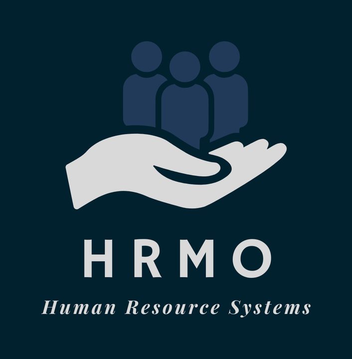
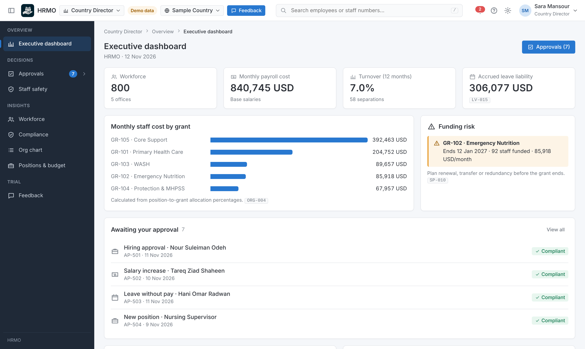
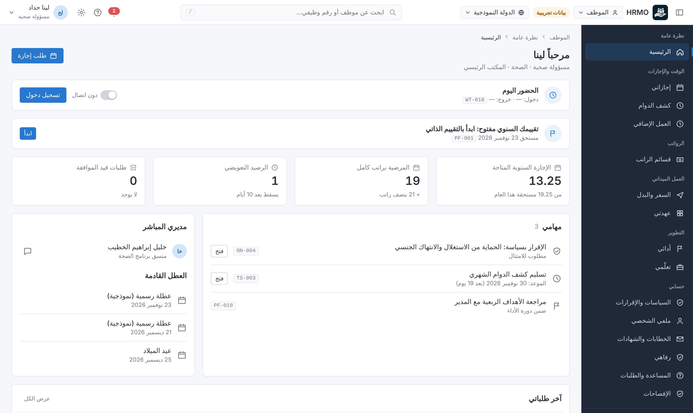
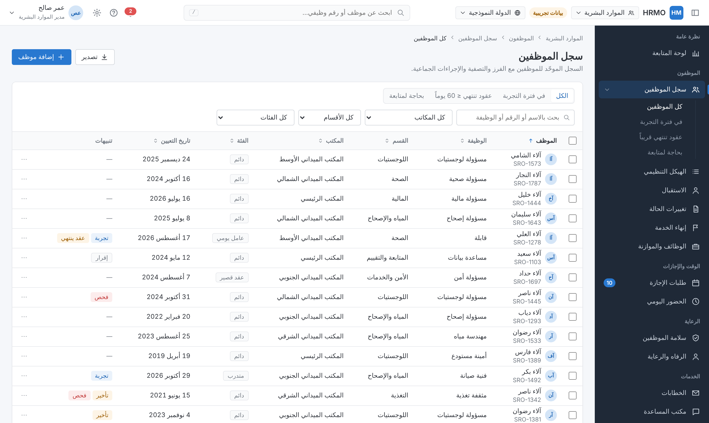
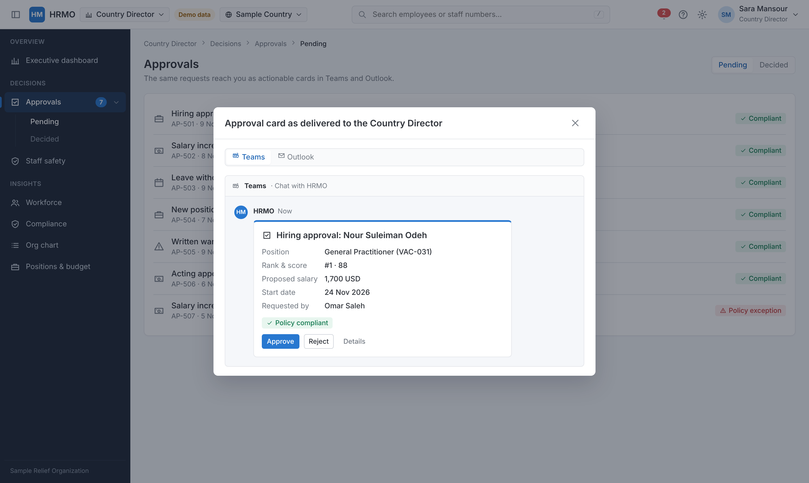
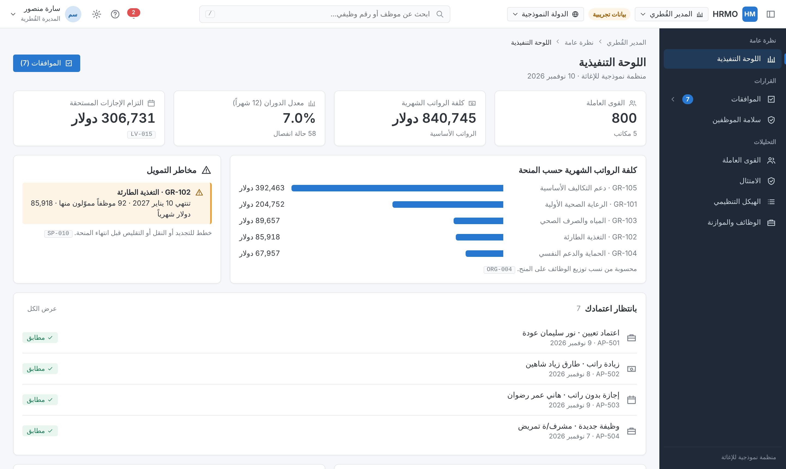
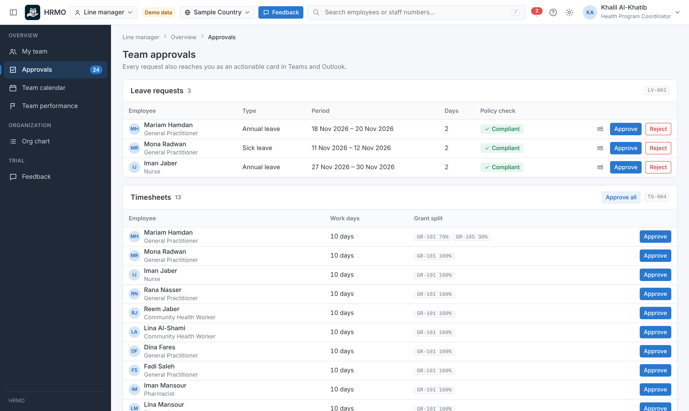
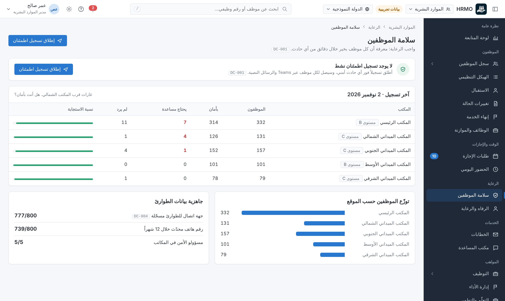

<p align="center"></p>

# HRMO

Configurable HR management system for humanitarian and non-profit organizations. Built on **Microsoft Azure** and runs entirely within the Microsoft ecosystem.

نظام قابل للتهيئة لإدارة الموارد البشرية في المؤسسات الإنسانية وغير الربحية. مبني على **Microsoft Azure** ويعمل داخل نظام مايكروسوفت بالكامل.



## Live demo / العرض التفاعلي

The demo in [`demo/`](demo/) runs entirely on GitHub Pages with fictitious data for 800 employees. No server, no sign-in.

نسخة العرض في مجلد `demo/` تعمل بالكامل على GitHub Pages ببيانات وهمية لـ 800 موظف، دون خادم أو تسجيل دخول.

| Workspace / الواجهة | What it shows / ما تعرضه |
|---|---|
| **Employee** / الموظف | Leave with instant policy checks, timesheets with grant allocation, overtime, payslips, letters (salary, experience, embassy), performance self-assessment and objectives, learning, travel requests, equipment, declarations (conflict of interest, gifts), HR helpdesk, wellbeing and confidential support, safety check-in replies, resignation |
| **Line manager** / المدير المباشر | Team overview, one approvals inbox (leave, timesheets, overtime, travel, appraisals), team leave calendar, performance reviews and improvement plans, org chart |
| **HR** / الموارد البشرية | Dashboard and HR metrics, 800-employee directory, onboarding checklists, changes of status, separations with clearance and final settlement, positions and budget, leave and attendance, recruitment with mandatory gates (incl. misconduct disclosure screening), performance cycle, learning and training needs, staff safety check-ins, wellbeing (R&R, burnout watch, hardship), professional licences, letters, helpdesk, disciplinary and grievance cases with warning ladder, declarations, travel and security clearance, assets, emergency surge roster, audit log, **live policy settings** |
| **Country Director** / المدير القُطري | Executive dashboard (payroll cost by grant, funding risk, turnover, end-of-service and leave liabilities, diversity and localization), approvals with automatic policy checks (hires, changes of status, sanctions, positions), staff safety, workforce analytics |

Approvals are shown as they arrive in **Teams chat** and **Outlook** as actionable cards. The demo supports Arabic (RTL) and English, light and dark themes, and phone screens.

تظهر الموافقات كما تصل في **دردشة Teams** و**Outlook** كبطاقات تفاعلية. يدعم العرض العربية والإنجليزية، والوضعين الفاتح والداكن، وشاشات الهاتف.

### Design system / نظام التصميم
A clean, information-dense enterprise design system defined by central tokens in [`demo/assets/styles.css`](demo/assets/styles.css): colors (primary `#2878D0`, navy `#1F2937`, background `#F5F7FA`), typography (Inter / IBM Plex Sans Arabic), 4px spacing grid, radius, elevation, component dimensions, icon sizes and interaction states. Components include a top bar with workspace switcher, notifications, help, preferences and user menu; a collapsible grouped sidebar with sub-menus; breadcrumbs; data tables with sorting, multi-select, bulk actions, row menus and pagination; confirmation dialogs, toasts, tooltips, toggles, radios, date pickers, empty states and loading skeletons.

نظام تصميم مؤسسي واضح وكثيف المعلومات، معرَّف بمتغيرات مركزية: الألوان والخطوط والمسافات والزوايا والظلال وأبعاد المكونات وأحجام الأيقونات وحالات التفاعل.

### Publish the demo / نشر العرض
1. Push this repository to GitHub. / ارفع المستودع إلى GitHub.
2. The workflow [`.github/workflows/pages.yml`](.github/workflows/pages.yml) copies `demo/` to the `gh-pages` branch on every push to `main` (or run it manually from **Actions → Publish demo → Run workflow**). / يُنسخ مجلد `demo/` تلقائياً إلى فرع `gh-pages`.
3. **Settings → Pages → Source: Deploy from a branch → `gh-pages` / `(root)` → Save** (one time). / مرة واحدة فقط.

To run locally, open `demo/index.html` in a browser. / للتشغيل محلياً افتح `demo/index.html` في المتصفح.

| | |
|---|---|
|  |  |
|  |  |
|  |  |

## Documentation / التوثيق

| | English | العربية |
|---|---|---|
| Functional system reference / المرجع الوظيفي | [docs/en/system-reference.md](docs/en/system-reference.md) | [docs/ar/system-reference.md](docs/ar/system-reference.md) |

Every rule shown in the demo (e.g. `LV-062`) links back to a rule ID in the system reference. / كل قاعدة تظهر في العرض (مثل `LV-062`) مرتبطة بمعرّف في المرجع الوظيفي.

## Configuration / الإعداد

[`data/config-defaults/policy-defaults.json`](data/config-defaults/policy-defaults.json) is the default policy template. Every key maps to a rule ID in the system reference.

القالب الافتراضي للسياسات، وكل مفتاح فيه مرتبط بمعرّف قاعدة في المرجع.

> Default values are examples and must be verified against each customer's policies and local labor law.
> القيم الافتراضية أمثلة، ويجب مطابقتها مع سياسات كل عميل وقانون العمل المحلي.

## Repository structure / هيكل المستودع

```
demo/              interactive demo (GitHub Pages) — no dependencies
docs/              functional reference + production architecture (en/ar) + screenshots
data/              policy defaults
infra/             Azure infrastructure template (Bicep)
db/                core database schema (Azure SQL, row-level security)
api/               API contract (OpenAPI)
.github/workflows  Pages deployment
```

### Production / التشغيل الفعلي
The production design runs in the customer's own Azure subscription with Microsoft Entra ID sign-in: [architecture (EN)](docs/en/architecture.md) · [المعمارية (AR)](docs/ar/architecture.md). Phase 1 (infrastructure template, schema, API contract) is in this repository; the API implementation is next.

تصميم التشغيل الفعلي يعمل داخل اشتراك Azure الخاص بالمؤسسة بدخول Microsoft Entra ID. المرحلة الأولى (قالب البنية والمخطط وعقد الواجهة البرمجية) موجودة في المستودع، وتنفيذ الواجهة البرمجية هو التالي.

---
*Microsoft, Teams and Outlook are trademarks of Microsoft. This project is not affiliated with or endorsed by Microsoft.*
