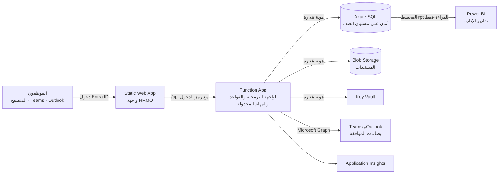

# HRMO — معمارية التشغيل الفعلي على Azure

**الحالة:** المرحلة الأولى (الأساس). نسخة العرض في `demo/` تعمل دون خادم، وهذه الوثيقة تشرح كيف يعمل المنتج نفسه فعلياً داخل بيئة مايكروسوفت الخاصة بالمؤسسة.

## 1. القرارات

| القرار | الاختيار | السبب |
|---|---|---|
| الاستضافة | Azure داخل **اشتراك المؤسسة نفسها** | البيانات لا تخرج من بيئة المؤسسة، وهي أقل كلفة تحمي بيانات الموارد البشرية |
| الهوية | Microsoft Entra ID لمستأجر واحد | يدخل الموظف بحساب العمل، وتسري سياسات المؤسسة مثل التحقق الثنائي |
| الواجهة البرمجية | Azure Functions بلغة TypeScript | لغة الواجهة نفسها، فتُكتب قواعد التحقق مرة واحدة |
| قاعدة البيانات | Azure SQL Database | أمان على مستوى الصف، وتاريخ زمني للتغييرات، وتشفير افتراضي |
| الواجهة | واجهة HRMO الحالية على Azure Static Web Apps | دون إعادة تصميم، وتُفتح كتبويب داخل Teams |
| الأسرار | لا أسرار في الكود أو الإعدادات | الواجهة البرمجية تستخدم هوية مُدارة للوصول إلى SQL والتخزين وKey Vault |

## 2. المكونات

| المكوّن | خدمة Azure | الدور |
|---|---|---|
| الواجهة | Static Web Apps (القياسية) | تعرض واجهة HRMO وتحوّل `/api` إلى تطبيق الدوال المرتبط |
| الواجهة البرمجية | Functions (Flex Consumption) | تتحقق من هوية المستخدم، تطبّق القواعد، تقرأ وتكتب البيانات، وتشغّل المهام المجدولة |
| البيانات | SQL Database (فئة Basic بدايةً) | الموظفون والإجازات والموافقات ومجموعات السياسات وسجل التدقيق |
| المستندات | Blob Storage | العقود والخطابات والمرفقات، مع حفظ الإصدارات واسترجاع المحذوف 14 يوماً |
| الأسرار | Key Vault | بيانات اعتماد Graph والرسائل النصية عند المرحلة الثالثة |
| المراقبة | Application Insights وLog Analytics | الأخطاء والأداء وسجلات تدقيق SQL (احتفاظ 30 يوماً، وحد 1 غيغابايت يومياً) |

الملفات: [`infra/main.bicep`](../../infra/main.bicep)، [`db/schema.sql`](../../db/schema.sql)، [`db/reporting.sql`](../../db/reporting.sql)، [`api/openapi.yaml`](../../api/openapi.yaml).

## 3. الأمان والسرية

| الخطر | الضابط |
|---|---|
| دخول شخص من خارج المؤسسة | تطبيق Entra ID لمستأجر واحد، فلا يحصل على رمز دخول إلا حساب في دليل المؤسسة |
| موظف يقرأ سجل غيره | أمان على مستوى الصف في SQL: الواجهة البرمجية تثبّت رقم الموظف ودوره على الاتصال، والقاعدة تصفّي كل استعلام. خطأ في الواجهة البرمجية لا يُرجع صفوف الآخرين |
| مدير يرى الرواتب أو البيانات الطبية | بيانات الرواتب والبيانات الخاصة في جداول منفصلة لا يقرؤها دور المدير (القاعدة MG-004) |
| تجاوز القواعد من المتصفح | القواعد الـ 304 كلها تُطبّق في الواجهة البرمجية، والمتصفح يعرض النتيجة فقط |
| سرقة كلمة مرور أو نص اتصال | لا وجود لهما: SQL بدخول Entra فقط، ومفاتيح التخزين معطّلة، والواجهة البرمجية بهوية مُدارة |
| قراءة البيانات من القرص أو النسخ الاحتياطية | تشفير شفاف في SQL، وتشفير عند التخزين، و TLS 1.2 حداً أدنى عند النقل |
| تغييرات بلا أثر | الجداول الزمنية تحفظ كل نسخة سابقة، وجدول التدقيق للإضافة فقط، وتدقيق SQL يُرسل إلى Log Analytics |
| حذف بالخطأ | استرجاع SQL إلى نقطة زمنية، وإصدارات الملفات، وحماية Key Vault من المسح |
| موقع البيانات | المؤسسة تختار منطقة Azure لكل موارد البيانات |

السياسة الكاملة والمسؤوليات وقائمة التحقق قبل التشغيل: [security.md](security.md).

**خارج النطاق عمداً:** لا يستقبل النظام بلاغات المخالفات أو التحرش أو الاحتيال أو الحماية، ويحيل إلى قناة المؤسسة المستقلة.

**خيارات تشديد إضافية (بكلفة):** نقاط نهاية خاصة لـ SQL والتخزين مع ربط بالشبكة الافتراضية، وMicrosoft Defender for SQL، ونسخ احتياطية متعددة المناطق.

## 4. الكلفة

كلفة شهرية تقديرية لنحو 800 موظف. **يُؤكَّد كل رقم من حاسبة أسعار Azure للمنطقة المختارة قبل أي عرض سعر.**

| الخدمة | الفئة | التقدير |
|---|---|---|
| Static Web Apps | القياسية | نحو 9 دولارات |
| Functions | Flex Consumption | صفر ضمن المنحة المجانية الشهرية |
| SQL Database | Basic (أو S0 عند الحاجة) | نحو 5 إلى 15 دولاراً |
| التخزين وKey Vault والمراقبة | حسب الاستهلاك | نحو 1 إلى 5 دولارات |
| **الإجمالي** | | **نحو 15 إلى 30 دولاراً** |

المؤسسات غير الربحية المؤهلة تحصل على رصيد Azure بقيمة 2,000 دولار سنوياً عبر برنامج Microsoft for Nonprofits، وهو يغطي هذه الكلفة. المنحة تُجدَّد سنوياً والرصيد غير المستخدم لا يُرحَّل.

يمكن تشغيل تجربة بلا كلفة على Static Web Apps المجانية وعرض Azure SQL المجاني، لكنهما بلا ضمان توافر، والقاعدة المجانية تتوقف عند استنفاد حصتها الشهرية. تصلح لمكتب واحد لا للتشغيل الفعلي.

## 5. النشر

المتطلبات: اشتراك Azure، وصلاحية إنشاء تسجيل تطبيق، ومجموعة Entra لمسؤولي SQL.

1. إنشاء مجموعة موارد في المنطقة المطلوبة.
2. تعديل `infra/main.parameters.json` (معرّف مجموعة مسؤولي SQL واسمها).
3. `az deployment group create -g <resource-group> -f infra/main.bicep -p infra/main.parameters.json`
4. الاتصال بالقاعدة كعضو في مجموعة المسؤولين، وتشغيل `db/schema.sql`، ثم إنشاء مستخدم الواجهة البرمجية (الخطوة 0 في الملف). يشغل `db/reporting.sql` عند الحاجة لتقارير Power BI.
5. تسجيل تطبيق HRMO في Entra ID (مستأجر واحد، النطاق `access_as_user`) ومنح موافقة المسؤول.
6. ربط GitHub بـ Azure وتشغيل سير العمل **Deploy to Azure**: انظر [azure-setup.md](azure-setup.md). الخطوات 1 إلى 3 تصبح آلية.
7. نشر حزمة تطبيق Teams في كتالوج تطبيقات المؤسسة (المرحلة الثالثة).

## 6. المراحل

| المرحلة | النطاق | الحالة |
|---|---|---|
| 1. الأساس | المعمارية، قالب البنية، المخطط الأساسي، عقد الواجهة البرمجية | **هذا التغيير** |
| 2. النواة | واجهة برمجية للهوية والموظفين والإجازات والموافقات، وربط الواجهة بها بدل تخزين المتصفح، والنشر الآلي | التالية |
| 3. التكامل | تبويب Teams وبطاقات الموافقة، رسائل Outlook التفاعلية، المهام المجدولة، الرسائل النصية، حزمة تقارير Power BI | مخططة |
| 4. الوحدات | بقية الوحدات بالترتيب الذي تختاره المؤسسة، وترحيل البيانات | مخططة |

## 7. طبقة التقارير (Power BI)

تبنى تقارير الإدارة في Power BI على نموذج نجمي موجود **داخل قاعدة HRMO نفسها** في المخطط `rpt` ([`db/reporting.sql`](../../db/reporting.sql)). لا يوجد مستودع بيانات مستقل ولا مسارات نقل بيانات تحتاج تشغيلا أو كلفة.

| المعمارية التحليلية المعتادة | في HRMO |
|---|---|
| مصادر البيانات | قاعدة HRMO |
| Azure Data Factory | غير مطلوب: المصدر واحد |
| الطبقات Bronze / Silver / Gold | عروض `rpt`: بيانات منظفة ومهيأة للتقارير |
| مستودع البيانات | القاعدة نفسها |
| Power BI | يتصل بالمخطط `rpt` فقط |

**النموذج**

| النوع | العناصر |
|---|---|
| الأبعاد | `DimDate`، `DimEmployee`، `DimOffice`، `DimDepartment`، `DimGrant`، `DimLeaveType` |
| الحقائق | `FactHeadcountMonthly` (يبنى من تاريخ التغييرات)، `FactLeave`، `FactLeaveBalance`، `FactApproval`، `FactGrantAllocation` |
| حقائق حساسة | `FactCompensation`، `FactGrantCost` |

**التقارير التي يدعمها:** تطور عدد الموظفين والدوران حسب المكتب والقسم، العقود والمنح القريبة من الانتهاء، الإجازات المأخوذة والأرصدة المتبقية، حجم الموافقات وزمن القرار (ونسبة ما يقرر من Teams وOutlook)، نسبة النساء والكوادر الوطنية في القيادة، كلفة الموظفين حسب المنحة.

**السرية**

- يدخل Power BI بهوية خاصة به ويقرأ المخطط `rpt` فقط، ولا يصل إلى الجداول الأساسية.
- دوران: `hrmo_reporting` (دون رواتب أو بيانات خاصة) و`hrmo_reporting_sensitive` (يضيف الرواتب). تقارير الرواتب تستخدم هوية مستقلة ومساحة عمل مقيدة.
- العروض لا تتضمن الرقم الوطني ولا بيانات البنك ولا أرقام الهواتف ولا أسباب الإجازات ولا ملفات القضايا.
- من يرى أي مكتب أو دولة داخل التقرير يحدد بأدوار أمان الصفوف في نموذج Power BI.
- أرقام التنوع تعرض مجمعة فقط، مع احترام الحد الأدنى لحجم المجموعة (القاعدة DI-004).

**الكلفة:** ترخيص Power BI لكل من يشاهد التقارير، لذلك يحصر المشاهدون في الإدارة والموارد البشرية. يؤكد السعر الحالي من مايكروسوفت.

**متى يضاف مستودع بيانات:** عند الحاجة لدمج بيانات من خارج HRMO (النظام المالي، ملفات الرواتب، بيانات المانحين)، أو توحيد عدة مؤسسات، أو عندما تبطئ الاستعلامات التاريخية الثقيلة قاعدة التشغيل. عندها يضاف Azure Data Factory ومستودع خلف أسماء `rpt` نفسها، فتبقى التقارير القائمة تعمل.

## 8. ما لم يُختبر بعد

كُتب قالب البنية والمخطط وعقد الواجهة البرمجية دون اشتراك Azure للاختبار. فُحص ملف OpenAPI من حيث البنية فقط. أول اختبار فعلي هو الخطوة 3 من النشر في اشتراك المؤسسة، ويُتوقع تصحيحات صغيرة (إصدارات الواجهات، توفر المناطق).

