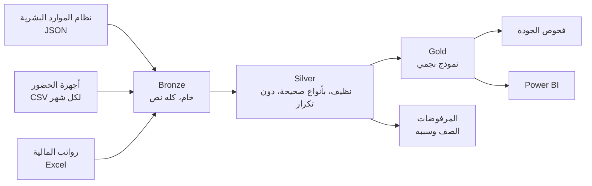

# منصة بيانات HRMO: مسار البيانات والمستودع وجودة البيانات

تقارير الموارد البشرية تحتاج بيانات لا توجد في مكان واحد: سجلات الموظفين في نظام الموارد البشرية، والحضور يأتي من الأجهزة كملفات، والرواتب في ملف Excel لدى المالية. هذا الجزء من HRMO يجمع المصادر الثلاثة في مستودع واحد يقرؤه Power BI، ويفحص البيانات في كل تشغيل.

كل البيانات هنا وهمية ويولدها سكربت.

## 1. المسار

| الطبقة | ما تحتويه | القاعدة |
|---|---|---|
| **Bronze** | كل مصدر كما وصل تماما، كل الأعمدة نص، مع اسم الملف ورقم الصف ووقت التحميل | لا تعدل، يضاف إليها فقط |
| **Silver** | أنواع بيانات صحيحة، رموز مرتبة، صف واحد لكل مفتاح | تبنى من جديد في كل تشغيل |
| **المرفوضات** | كل صف فشل في التنظيف مع السبب | لا يختفي صف دون أثر |
| **Gold** | الأبعاد والحقائق للتقارير | تبنى من جديد في كل تشغيل |

## 2. الملفات

| الملف | وظيفته |
|---|---|
| `generate_sources.py` | ينشئ ملفات المصادر الثلاثة، مع أخطاء مقصودة |
| `pipeline/extract.py` | يقرأ JSON وCSV وExcel إلى صفوف نصية |
| `pipeline/run_pipeline.py` | يشغل الخطوات بالترتيب، يقيس زمنها، يسجلها، ويكتب التقرير |
| `pipeline/db.py` | الاتصال بـ SQLite أو SQL Server |
| `sql/01_setup.sql` | المخططات وجداول Bronze وجداول السجل |
| `sql/02_silver.sql` | التنظيف وإزالة التكرار |
| `sql/03_gold.sql` | النموذج النجمي والفهارس |
| `sql/04_quality_checks.sql` | قواعد الجودة |
| `tests/test_pipeline.py` | اختبار شامل للمسار |
| `benchmark.py` | يقيس أثر الفهارس |

## 3. كيف تعمل كل خطوة

**الاستخراج.** لكل ملف بصمة (SHA-256 لمحتواه) تحفظ في `etl.file_log`. الملف الذي بصمته موجودة يتخطى، فتشغيل المسار مرتين لا يحمل البيانات نفسها مرتين. الملفات الشهرية الجديدة تلتقط تلقائيا.

**التنظيف (Silver).** ثلاث حركات متكررة لكل مصدر:

1. تحويل كل عمود بـ `TRY_CAST`، التي ترجع NULL بدل أن تفشل عند قيمة خاطئة، وتسجيل أول سبب يجعل الصف غير صالح.
2. الاحتفاظ بالصفوف الصالحة، صف واحد لكل مفتاح. الدالة `ROW_NUMBER() OVER (PARTITION BY key ORDER BY updated_at DESC)` ترقم النسخ، ويحتفظ بالرقم 1 فقط.
3. كتابة كل ما عدا ذلك في `silver.reject` مع سببه.

**النموذج (Gold).**

| الجدول | مستوى التفصيل | ملاحظات |
|---|---|---|
| `DimDate` | صف لكل يوم | السنة، الربع، الشهر، يوم الأسبوع |
| `DimEmployee` | صف لكل موظف | دون راتب: الرواتب في جدول الحقائق فقط |
| `DimOffice`، `DimDepartment` | صف لكل رمز | |
| `FactAttendance` | موظف × يوم | الساعات، التأخير، عدم اكتمال التسجيل |
| `FactPayroll` | موظف × شهر | الإجمالي، الخصومات، الصافي |

الحقائق تشير إلى الأبعاد بمفاتيح رقمية. مفاتيح التاريخ بصيغة `yyyymmdd`.

**الفحص.** كل قاعدة في `04_quality_checks.sql` استعلام واحد يرجع عدد الصفوف المخالفة. قواعد `ERROR` توقف المسار برمز خروج غير صفري، وقواعد `WARN` تظهر في التقرير فقط.

| نوع الفحص | مثال |
|---|---|
| المطابقة | صفوف Bronze = صفوف Silver + المرفوضات |
| التفرد | رقم الموظف يظهر مرة واحدة في `DimEmployee` |
| سلامة المراجع | كل صف حقائق يشير إلى موظف وتاريخ موجودين |
| المجاميع | صافي الرواتب في Gold يساوي صافيها في Silver |
| المدى | ساعات اليوم بين 0 و16 |
| الاكتمال (تحذير) | خروج غير مسجل، جنس غير مسجل، موظف دون راتب |

## 4. نتيجة التشغيل

بالمصادر المولدة (800 موظف، ثلاثة أشهر):

| المصدر | المستلم | المقبول | المرفوض | المكرر |
|---|---:|---:|---:|---:|
| الموظفون | 815 | 795 | 8 | 12 |
| الحضور | 49,024 | 48,506 | 368 | 150 |
| الرواتب | 2,400 | 2,364 | 36 | 0 |

تنجح الفحوص العشرة من مستوى الخطأ. وتظهر 4 تحذيرات: 79 صف حضور دون خروج، 6 موظفين دون جنس مسجل، 7 موظفين دون راتب في آخر شهر، 412 صفا مرفوضا.

ملاحظة تستحق الانتباه: رفض 5 موظفين بسبب تاريخ تعيين غير صالح، وهذا وحده أدى إلى رفض 335 صف حضور و21 صف رواتب بسبب "موظف غير معروف". خطأ صغير في سجل أساسي ينتشر إلى كل جدول يعتمد عليه، ولهذا تحفظ المرفوضات مع أسبابها.

**الفهارس.** السكربت `benchmark.py` يشغل ملخص حضور موظف 300 مرة. على جهاز الاختبار: 1.21 ملي ثانية للاستعلام دون الفهرس و0.05 ملي ثانية معه (نحو 26 ضعفا) على 48,506 صفوف حقائق. الأرقام تختلف حسب الجهاز والمحرك.

## 5. الأمان

- الراتب موجود في `FactPayroll` فقط وليس في بعد الموظف، فيمكن منح صلاحية الرواتب منفصلة عن صلاحية الأعداد والحضور.
- طبقة Bronze تحفظ بيانات المصادر الخام، ويجب أن يقرأها المسار فقط.
- لا بيانات حقيقية ولا كلمات مرور في المستودع. نص الاتصال بـ SQL Server يمرر وقت التشغيل.

## 6. SQL Server و SQLite

ملفات SQL مكتوبة بلغة T-SQL لـ SQL Server، وهو هدف التشغيل الفعلي. لتشغيلها واختبارها على أي جهاز دون خادم، يستطيع `pipeline/db.py` تشغيل الملفات نفسها على SQLite بترجمة أربعة أشياء: أسماء المخططات (`bronze.x` تصبح `bronze_x`)، و`TRY_CAST`، و`DATEDIFF(minute, …)`، و`YEAR/MONTH/DAY`.

**الحالة:** المسار والاختبارات وقياس الأداء تعمل على SQLite، وسير عمل GitHub Actions يعيد تشغيلها مع كل تعديل. مسار SQL Server (`--engine mssql`) لم يشغل بعد، ويتوقع تصحيحات صغيرة عند أول تشغيل.

## 7. الخطوات التالية

| الخطوة | السبب |
|---|---|
| التشغيل على SQL Server أو Azure SQL | يؤكد صحة T-SQL على المحرك الحقيقي |
| الجدولة بـ Azure Data Factory | مسار واحد فيه نشاط نسخ لكل مصدر ونشاط إجراء مخزن لكل ملف SQL، بمشغل شهري |
| تحميل تزايدي لـ Silver و Gold | معالجة الملفات الجديدة فقط بدل إعادة البناء، ويلزم عند كبر الحجم |
| تاريخ في `DimEmployee` (بعد متغير ببطء من النوع الثاني) | تقارير حسب المكتب أو الدرجة التي كان عليها الموظف وقتها |
| قراءة الموظفين من واجهة HRMO البرمجية | تحل محل ملف JSON بعد نشر الواجهة |

