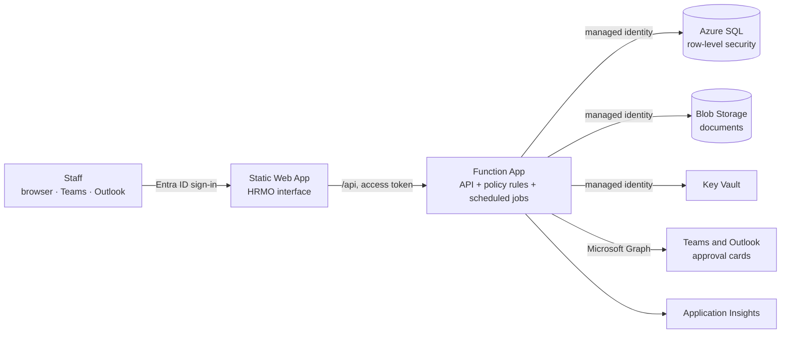

# HRMO — Production architecture on Azure

**Status:** phase 1 (foundation). The interactive demo in `demo/` has no server; this document describes how the same product runs in production inside an organisation's own Microsoft environment.

## 1. Decisions

| Decision | Choice | Why |
|---|---|---|
| Hosting | Azure, in the **customer's own subscription** | Data never leaves the organisation's tenant; lowest cost that still protects HR data |
| Identity | Microsoft Entra ID, single tenant | Staff sign in with their work account; the organisation's MFA and conditional-access rules apply |
| API | Azure Functions, TypeScript | Same language as the front end, so validation rules are written once |
| Database | Azure SQL Database | Row-level security, temporal history, encryption at rest by default |
| Front end | The existing HRMO interface on Azure Static Web Apps | No redesign; also opens as a tab inside Teams |
| Secrets | None in code or settings | The API uses a managed identity for SQL, Storage and Key Vault |

## 2. Components

| Component | Azure service | Role |
|---|---|---|
| Interface | Static Web Apps (Standard) | Serves the HRMO front end; forwards `/api` to the linked Function App |
| API | Functions (Flex Consumption) | Authenticates the caller, evaluates policy rules, reads and writes data, runs timers |
| Data | SQL Database (Basic to start) | Employees, leave, approvals, policy sets, audit trail |
| Documents | Blob Storage | Contracts, letters, attachments; versioning and 14-day soft delete |
| Secrets | Key Vault | Graph and SMS credentials when phase 3 needs them |
| Monitoring | Application Insights + Log Analytics | Errors, performance, SQL audit logs (30-day retention, 1 GB/day cap) |

Files: [`infra/main.bicep`](../../infra/main.bicep), [`db/schema.sql`](../../db/schema.sql), [`api/openapi.yaml`](../../api/openapi.yaml).

## 3. Security and confidentiality

| Risk | Control |
|---|---|
| Someone outside the organisation signs in | Single-tenant Entra ID app; only accounts in the organisation's directory get a token |
| A user reads another person's record | SQL row-level security: the API sets the caller's employee ID and role on the connection, and the database filters every query. A bug in the API cannot return other rows |
| A manager sees salaries or medical data | Compensation and private data are in separate tables that the manager role cannot read (rule MG-004) |
| Rules bypassed from the browser | All 292 rules are evaluated in the API; the browser only displays the result |
| Stolen password or connection string | There are none: SQL is Entra-only, Storage has shared keys disabled, the API uses a managed identity |
| Data read from disk or backups | Transparent data encryption on SQL, encryption at rest on Storage, TLS 1.2 minimum in transit |
| Changes without trace | Temporal tables keep every previous version; the audit table is append-only for the API; SQL auditing goes to Log Analytics |
| Accidental deletion | SQL point-in-time restore, blob versioning and soft delete, Key Vault purge protection |
| Data residency | The organisation chooses the Azure region for all data resources |

**Out of scope on purpose:** whistleblowing, harassment, fraud and safeguarding reports are not collected. The system links to the organisation's independent channel.

**Hardening options (extra cost):** private endpoints for SQL and Storage with virtual-network integration, Microsoft Defender for SQL, geo-redundant backups.

## 4. Cost

Indicative monthly cost for about 800 staff. **Confirm every figure in the Azure pricing calculator for the chosen region before quoting.**

| Service | Tier | Estimate |
|---|---|---|
| Static Web Apps | Standard | about $9 |
| Functions | Flex Consumption | $0 within the monthly free grant |
| SQL Database | Basic (S0 if needed) | about $5–15 |
| Storage, Key Vault, monitoring | Pay as you go | about $1–5 |
| **Total** | | **about $15–30** |

Eligible non-profits receive $2,000 per year in Azure credits through Microsoft for Nonprofits, which covers this footprint. The grant is renewed yearly and unused credit does not roll over.

A zero-cost pilot is possible with Static Web Apps Free and the Azure SQL free offer, but neither has an SLA and the free database pauses when its monthly allowance is used. Use it for one office, not for production.

## 5. Deployment

Prerequisites: an Azure subscription, permission to create an app registration, and an Entra group for SQL administrators.

1. Create a resource group in the required region.
2. Edit `infra/main.parameters.json` (SQL admin group ID and name).
3. `az deployment group create -g <resource-group> -f infra/main.bicep -p infra/main.parameters.json`
4. Connect to the database as a member of the admin group, run `db/schema.sql`, then create the API user (step 0 in the script).
5. Register the HRMO application in Entra ID (single tenant, scope `access_as_user`) and grant admin consent.
6. Deploy the front end and API from GitHub Actions (added in phase 2).
7. Publish the Teams app package to the organisation's app catalogue (phase 3).

## 6. Phases

| Phase | Scope | State |
|---|---|---|
| 1. Foundation | Architecture, infrastructure template, core schema, API contract | **This change** |
| 2. Core | API for identity, employees, leave, approvals; front end reads from the API instead of browser storage; CI/CD | Next |
| 3. Integration | Teams tab and approval cards, Outlook actionable messages, scheduled jobs, SMS | Planned |
| 4. Modules | Remaining modules in the order the customer chooses; data migration | Planned |

## 7. Not yet verified

The infrastructure template, schema and API contract were written without access to an Azure subscription. The OpenAPI file was validated for structure only. The first real test is step 3 of the deployment in the customer's subscription; expect small corrections (API versions, region availability).
