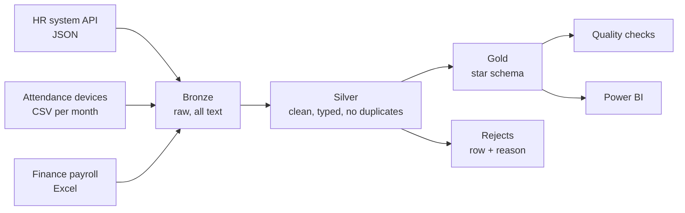

# HRMO data platform — pipeline, warehouse and data quality

HR reporting needs data that does not live in one place: employee records are in the HR system, attendance comes from devices as files, and payroll is a workbook kept by Finance. This part of HRMO brings the three together into one warehouse that Power BI can read, and checks the data on every run.

All data here is fictitious and generated by a script.

## 1. Flow



| Layer | What it holds | Rule |
|---|---|---|
| **Bronze** | Each source exactly as received, every column as text, plus file name, row number and load time | Never changed, only added to |
| **Silver** | Real types, tidy codes, one row per business key | Rebuilt on every run |
| **Rejects** | Every row that failed cleaning, with the reason | No row disappears silently |
| **Gold** | Dimensions and facts for reports | Rebuilt on every run |

## 2. Files

| File | What it does |
|---|---|
| `generate_sources.py` | Creates the three source files, with mistakes added on purpose |
| `pipeline/extract.py` | Reads JSON, CSV and Excel into rows of text |
| `pipeline/run_pipeline.py` | Runs the steps in order, times them, logs them, writes the report |
| `pipeline/db.py` | Connects to SQLite or SQL Server |
| `sql/01_setup.sql` | Schemas, bronze tables, log tables |
| `sql/02_silver.sql` | Cleaning and de-duplication |
| `sql/03_gold.sql` | Star schema and indexes |
| `sql/04_quality_checks.sql` | The quality rules |
| `tests/test_pipeline.py` | End-to-end test |
| `benchmark.py` | Measures the effect of the indexes |

## 3. How each step works

**Extract.** Each file gets a fingerprint (SHA-256 of its content) stored in `etl.file_log`. A file whose fingerprint is already there is skipped, so running the pipeline twice does not load the same data twice. New monthly files are picked up automatically.

**Clean (silver).** The same three moves for every source:

1. Convert each column with `TRY_CAST`, which returns NULL instead of failing on a bad value, and record the first reason a row is invalid.
2. Keep valid rows, one per business key. `ROW_NUMBER() OVER (PARTITION BY key ORDER BY updated_at DESC)` numbers the copies, and only number 1 is kept.
3. Write everything else to `silver.reject` with its reason.

**Model (gold).**

| Table | Grain | Notes |
|---|---|---|
| `DimDate` | One row per day | Year, quarter, month, weekday |
| `DimEmployee` | One row per employee | No salary: pay is only in the fact table |
| `DimOffice`, `DimDepartment` | One row per code | |
| `FactAttendance` | Employee × day | Hours, late flag, incomplete flag |
| `FactPayroll` | Employee × month | Gross, deductions, net |

Facts point to dimensions with integer keys. Date keys are written as `yyyymmdd`.

**Check.** Each rule in `04_quality_checks.sql` is one query that returns the number of rows that break it. `ERROR` rules stop the pipeline with a non-zero exit code; `WARN` rules are reported.

| Kind of check | Example |
|---|---|
| Reconciliation | Rows in bronze = rows in silver + rows rejected |
| Uniqueness | A staff number appears once in `DimEmployee` |
| Referential integrity | Every fact row points to an existing employee and date |
| Totals | Net pay in gold equals net pay in silver |
| Range | Hours in a day are between 0 and 16 |
| Completeness (warning) | Missing check-out, gender not recorded, employee without pay |

## 4. Result of a run

With the generated sources (800 employees, three months):

| Source | Received | Kept | Rejected | Duplicates |
|---|---:|---:|---:|---:|
| Employees | 815 | 795 | 8 | 12 |
| Attendance | 49,024 | 48,506 | 368 | 150 |
| Payroll | 2,400 | 2,364 | 36 | 0 |

10 error-level checks pass. 4 warnings are reported: 79 attendance rows without check-out, 6 employees without gender, 7 employees without pay in the latest month, 412 rejected rows.

One finding worth noticing: 5 employees were rejected for an invalid hire date, and that alone caused 335 attendance rows and 21 payroll rows to be rejected as "unknown employee". A small error in a master record spreads to every table that depends on it, which is why rejects are kept with their reason.

**Indexes.** `benchmark.py` runs an employee's attendance summary 300 times. On the test machine: 1.21 ms per query without the index, 0.05 ms with it (about 26 times faster) on 48,506 fact rows. Figures differ by machine and engine.

## 5. Security

- Salary is only in `FactPayroll`, not in the employee dimension, so access to pay can be granted separately from access to headcount and attendance.
- Bronze keeps raw source data and should be readable by the pipeline only.
- No real data and no passwords are in the repository. The SQL Server connection string is passed at run time.

## 6. SQL Server and SQLite

The SQL files are written in T-SQL for SQL Server, which is the production target. To run and test them on any machine with no server, `pipeline/db.py` can run the same files on SQLite by translating four things: schema names (`bronze.x` becomes `bronze_x`), `TRY_CAST`, `DATEDIFF(minute, …)` and `YEAR/MONTH/DAY`.

**State:** the pipeline, the tests and the benchmark run on SQLite, and the GitHub Actions workflow repeats them on every change. The SQL Server path (`--engine mssql`) has not been run yet; expect small fixes on the first run.

```bash
python pipeline/run_pipeline.py --engine mssql --target "Driver={ODBC Driver 18 for SQL Server};Server=...;Database=...;Authentication=ActiveDirectoryDefault"
```

## 7. Next steps

| Step | Why |
|---|---|
| Run on SQL Server / Azure SQL | Confirms the T-SQL on the real engine |
| Schedule with Azure Data Factory | One pipeline with a copy activity per source and a stored-procedure activity per SQL file, on a monthly trigger |
| Incremental silver and gold | Process only new files instead of rebuilding; needed when volumes grow |
| History in `DimEmployee` (slowly changing dimension type 2) | Reports by the office or grade an employee had at the time |
| Read employees from the HRMO API | Replaces the JSON file once the API is deployed |
